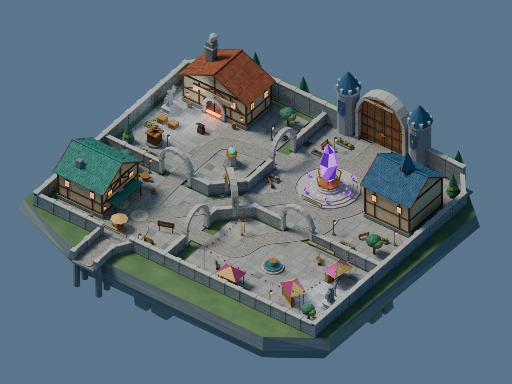

# Defenders of Atheria

A stylized Roblox tower defence project set in the kingdom of Atheria. Heroes defend sacred crystals that seal away an ancient evil; invading monsters seek to destroy the crystals and release it.

This repository contains the editable Blender lobby, Roblox Studio installation scripts, campaign-atlas artwork, and design previews developed so far. The lobby uses the **Linked Courtyards** layout: a crystal sanctuary, quest hall, forge, tavern, festival market, and battle gate.

## Start here

- **Editable lobby:** [blender/atheria_lobby.blend](blender/atheria_lobby.blend). This is revision 08, with the Festival Court sign removed.
- **Finished tavern interior:** [blender/tavern/atheria_tavern_finished.blend](blender/tavern/atheria_tavern_finished.blend) · [views](renders/tavern-finished/tavern_finished_views.pdf) · [notes](blender/tavern/README_FINISHED.md). Expanded room with materials, lighting, props, and a blank leaderboard.
- **Vestergate battlefield blockout:** [blender/vestergate/vestergate_blockout.blend](blender/vestergate/vestergate_blockout.blend) · [layout notes](blender/vestergate/README.md). Three woodland approaches, accessible defence terraces, a ridge bridge, and the defended crystal outside the kingdom gates.
- **Latest cleaned Vestergate map:** [Blender file](blender/vestergate/vestergate_cleaned.blend) · [repair script](blender/vestergate/repair_vestergate_terrain.py) · [cleanup notes](blender/vestergate/CLEANUP.md). Connected cliff terrain, grounded scenery and no grey reference characters.
- **Vestergate map renders:** [render-ready map](blender/vestergate/vestergate_render_ready.blend) · [seven views](renders/vestergate-finished/vestergate_full_map_views.pdf) · [render script](blender/vestergate/render_complete_map.py). Daylight renders of the full battlefield, crystal courtyard and all three lanes, including the reusable enemy portals.
- **Enemy portal designs:** [map and portal models](blender/vestergate/vestergate_with_portals.blend) · [comparison sheet](renders/vestergate-portals/enemy_portals_design_sheet.png) · [Blender script and notes](blender/vestergate/PORTALS.md). Three violet vortex variants at Vestergate's enemy lane entrances.
- **Reusable portal library:** [shared Blender assets](blender/assets/Atheria_Portal_Library.blend) · [placement script](blender/assets/place_enemy_portals.py) · [workflow](blender/assets/README.md). Reuse the portal designs across maps with independent placement transforms.
- **Texture exporter:** [blender/export_roblox.py](blender/export_roblox.py).
- **Studio setup order:** [docs/STUDIO_SETUP.md](docs/STUDIO_SETUP.md).
- **Campaign artwork:** [art/atlas/atheria_simple_atlas.png](art/atlas/atheria_simple_atlas.png).
- **Town views:** [renders/town/atheria_town_views.pdf](renders/town/atheria_town_views.pdf).

## Project contents

| Folder | Contents |
| --- | --- |
| `blender/` | Latest scene, procedural builder, texture exporter, render script, updates and historical generators |
| `roblox/interactions/` | Four service circles, visibility/clearance adjustments and raised effects |
| `roblox/ui/` | Battle Gate atlas, walk-in opening/closing, collision repair and illustrated-atlas update |
| `roblox/environment/` | Daytime sky, wall material and looping lobby music installers |
| `roblox/decor/` | Apples plaque for the back of the Quest Hall |
| `roblox/collision/` | Collision-fidelity repair for imported MeshParts |
| `art/` | Illustrated campaign atlas and original lobby layout concepts |
| `renders/` | Town, tavern interior, and engraving presentation images/PDFs |
| `docs/validation/` | Saved geometry validation reports from earlier revisions |

## Current state

The Blender model and Studio scripts are separate authoring assets. A Roblox `.rbxl` or `.rbxlx` place has not been exported into this workspace, so this repository does not contain a backup of edits saved only in Studio.

The campaign UI contains concept destinations, interactive selection, and **Normal / Intermediate / Expert** difficulty choices. Play and private-play buttons display coming-soon messages; no playable maps or matchmaking are connected.

## Blender

Open the supplied `.blend` in Blender 4.3 or later. The Python scripts run inside Blender, not ordinary Python. `render_all_views.py` renders the six town cameras.

For a procedural rebuild, run `build_atheria_town.py` in a new Blender file. This rebuilds revision 06 and replaces the current scene. Then apply `updates/atheria_sign_engraving_update.py` and `updates/remove_festival_sign.py`, and save the resulting scene. The included `.blend` already contains those updates.

The exporter bakes procedural base colors into PNG atlases and writes `Atheria_Roblox_Export/` beside the saved `.blend`. Keep the PNGs with the FBX. It preserves separate source objects, splits large meshes, and excludes render-hidden collections. Lighting and emissive effects are configured in Studio.

## Artwork and references

The reference-style atlas background was AI-generated for this project. Mission names and descriptions are concept names. The repository contains generated project assets, not the uploaded reference recordings or their extracted frames.
